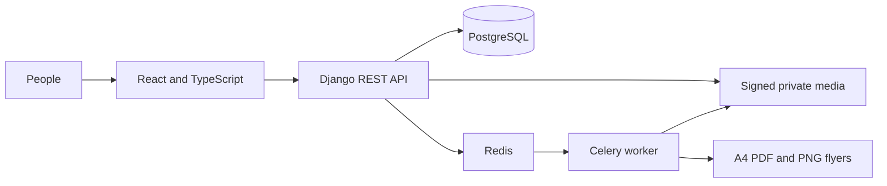

# PawPrint

<p align="center">
  <strong>Help lost pets find their way home.</strong><br>
  A public place to share lost-pet alerts, found-pet posts, and adoption flyers.
</p>

<p align="center">
  
  
  
  
  
</p>
<p align="center">
  
  
  
  
  
</p>

PawPrint brings lost-pet alerts, found-pet reports, and adoption outreach into one simple
workflow. Anyone can browse flyers, search for a pet, open the public map, or scan a flyer’s QR
code. Registered users can publish and manage their own posts.

## Three ways to help

| Flyer | What it shares |
| --- | --- |
| **Lost** | A high-contrast emergency alert with last-seen details, contact information, and a QR code. |
| **Found** | A clear post with where and when the pet was found, a photo, and a way to get in touch. |
| **Adoption** | A welcoming profile that helps adoptable pets find a home. |

Each pet has one photo. Uploads pass an animal-photo gate before private storage, and species,
breed, and color suggestions help people complete a flyer. Location details also appear on the
public pet map.

## Start locally

Docker Compose starts the API, frontend, database, and background worker together:

```bash
git clone https://github.com/bunokent/pawprint.git
cd pawprint
cp .env.example .env
docker compose up --build
```

Open the app at **http://localhost:5173**. The API is at **http://localhost:8000**, with its
interactive schema at **http://localhost:8000/api/docs**. The first image build downloads the
vision models directly; no Hugging Face token is needed. Development email is sent to a host
Mailpit instance on port `1025`. To run Mailpit in Compose too, use:

```bash
COMPOSE_EMAIL_HOST=mailpit docker compose --profile mailpit up --build
```

Google sign-in needs OAuth credentials in `.env`; email registration works without them. See
[`.env.example`](.env.example) for the available settings and
[the full documentation](docs/DOCUMENTATION.md) for the host-only setup.

## How it fits together



Photos and flyer exports stay outside the public web root. The app serves them through
short-lived signed URLs. Celery handles background image and flyer work, while Leaflet and
OpenStreetMap-based services power location search and the public map.

## Technology

| Area | Tools |
| --- | --- |
| Web app | React 19, TypeScript, Vite, Tailwind CSS, TanStack Query, Axios |
| API | Python 3.12, Django 5.2, Django REST Framework, drf-spectacular |
| Data and jobs | PostgreSQL 16, Redis 7, Celery, Django Channels |
| Pet photos | YOLO-World, CLIP, Pillow, private local storage |
| Maps and exports | Leaflet, Nominatim, WeasyPrint, Playwright, QR codes |
| Local development | Docker Compose, GitHub Actions |

Frontend API types are generated from the backend OpenAPI schema.

## Project map

```text
backend/                 Django API, domain apps, vision services, and flyer templates
frontend/                React application and Vite configuration
docs/DOCUMENTATION.md    Product, architecture, and operating guide
docker-compose.yml       Local database, cache, API, worker, and frontend services
```

## Development checks

```bash
cd backend
.venv/bin/ruff check .
.venv/bin/mypy apps

cd ../frontend
npm run lint
npm run build
```

GitHub Actions runs the backend lint checks and frontend type-check/build on pushes and pull
requests.
